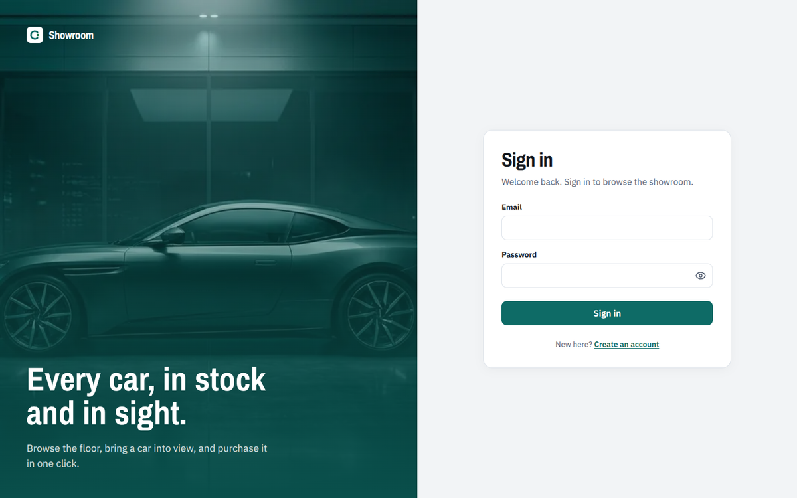
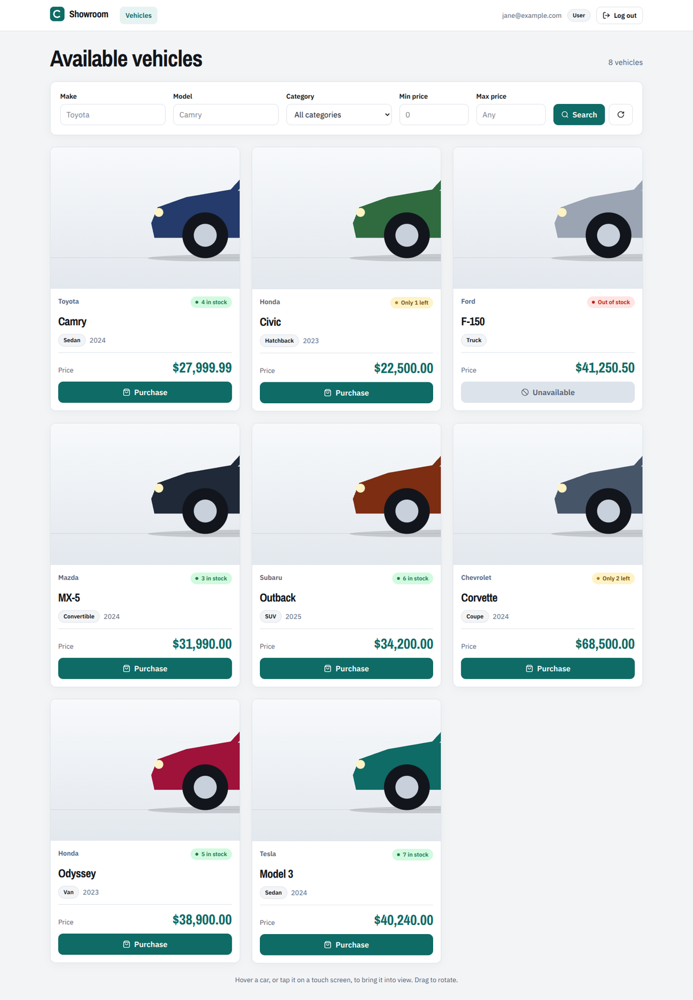
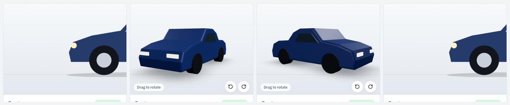
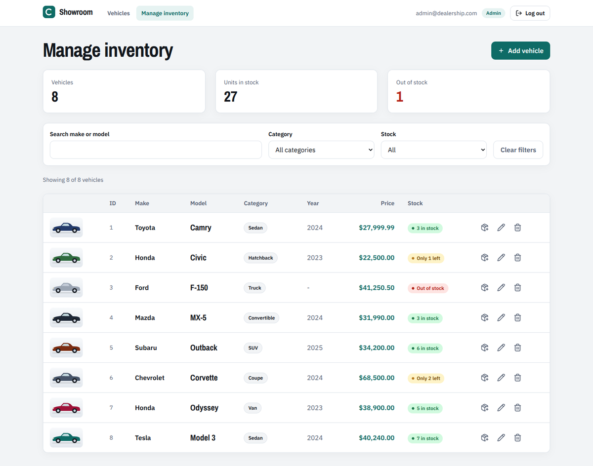
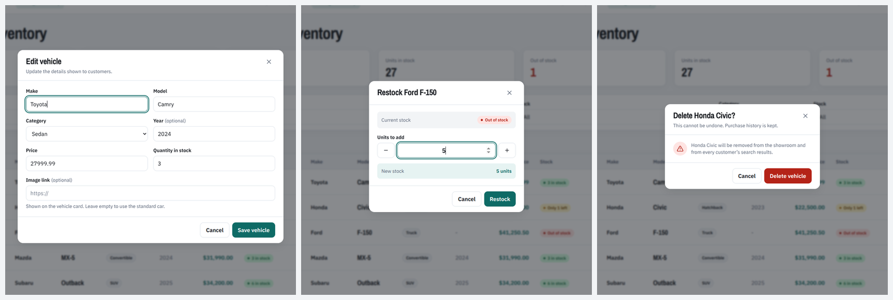
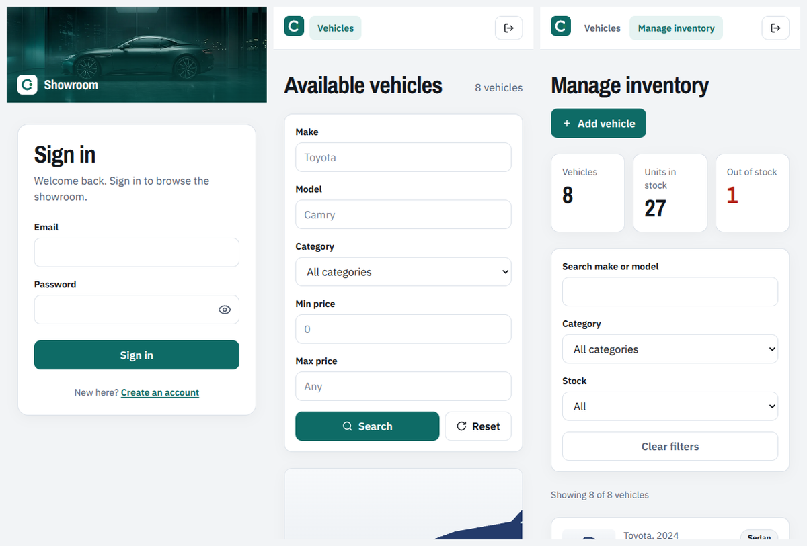
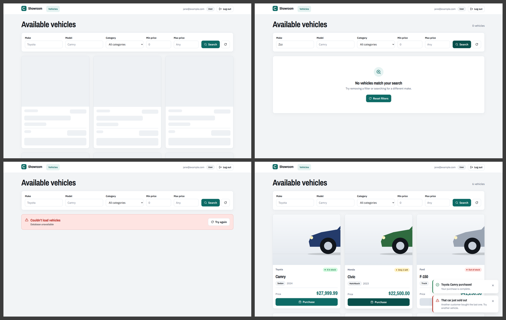

# Car Dealership Inventory System

A full-stack inventory app for a car dealership, built as a TDD kata.
Users register and log in, browse/search vehicles and purchase them (stock decreases).
Admins can also add, update, delete and restock vehicles.

> **Status:** skeleton. Structure, schema, migration and API contract are in place; features are built test-first.

## Tech stack
| Layer | Tech |
|---|---|
| API | Python 3.12, FastAPI, SQLAlchemy 2, Alembic, Pydantic v2 |
| Auth | JWT (PyJWT, HS256), bcrypt |
| Database | PostgreSQL 16 (via Docker Compose), psycopg 3 |
| Frontend | React 18, TypeScript, Vite, Tailwind CSS, React Router, TanStack Query, React Hook Form + Zod, React Three Fiber (3D cards) |
| Tests | pytest + pytest-cov (backend), Vitest + Testing Library + MSW (frontend) |

## Documentation
- [**Build guide: from zero to submission, mapped to the kata**](docs/BUILD_GUIDE.md)
- [**Setup guide: install and configure every tool, including PostgreSQL**](docs/SETUP_GUIDE.md)
- [Antigravity setup runbook: let an AI agent do the setup](docs/ANTIGRAVITY_SETUP.md)
- [Backend phases in detail, with verified hints](docs/NEXT_STEPS.md)
- [ER diagram](docs/ER_DIAGRAM.md) (Chen notation, PostgreSQL DDL)
- [Design review](docs/DESIGN_REVIEW.md) (what was kept, removed and fixed from the AI design export)
- [API contract and permission matrix](docs/API_CONTRACT.md)

## Run locally

### 1. Database
```bash
docker compose up -d db        # PostgreSQL on :5432 with `dealership` and `dealership_test` databases
```
(No Docker? Install PostgreSQL 14+ and create both `dealership` and `dealership_test` databases.)

### 2. Backend
```bash
cd backend
python -m venv .venv && source .venv/bin/activate      # Windows: .venv\\Scripts\\activate
pip install -r requirements-dev.txt
cp .env.example .env                                   # set a real SECRET_KEY
alembic upgrade head                                   # creates the tables
python -m app.scripts.doctor                           # checks tools, .env and both databases
python -m app.scripts.seed                             # creates the admin + sample data (after phase 11)
uvicorn app.main:app --reload                          # http://localhost:8000/docs
```

### 3. Frontend
```bash
cd frontend
cp .env.example .env
npm install
npm run dev                                            # http://localhost:5173
```

### Everything in Docker (optional)
```bash
docker compose up --build        # PostgreSQL, API :8000, UI :3000
```

### Seeded admin (for reviewers)
| Email | Password |
|---|---|
| `admin@dealership.com` | `Admin@12345` |

(Configurable via `ADMIN_EMAIL` / `ADMIN_PASSWORD` in `backend/.env`.)

## Tests
```bash
cd backend  && pytest          # needs `docker compose up -d db`; prints coverage, writes backend/reports/test-report.html
cd frontend && npm test
```
**Test report:** _paste the final pytest + coverage summary here._

## Screenshots
Captured from the production build against a mocked API while the backend was still in progress; retake them
against the real API before submitting.

| Login | Dashboard |
|---|---|
|  |  |

**3D vehicle card:** parked (only the nose visible), on hover, after dragging to rotate, and after leaving.



| Admin | Admin dialogs |
|---|---|
|  |  |



**Dashboard states:** loading skeletons, empty search, load error, and the purchase and sold-out toasts.



## My AI Usage
**Tools used:** _Claude (planning, backend skeleton, frontend), Google Stitch (UI exploration). Add any others._

**How I used them:** _e.g. brainstormed the stack and schema, generated the project skeleton, asked for edge cases
for my tests, debugged X._

**Reflection:** _what went well, what you had to correct, what you learned._

Raw chat logs are in [`PROMPTS.md`](PROMPTS.md).

## Project structure
```
backend/   app/{api,services,repositories,models,schemas,core,db,scripts}  alembic/  tests/{unit,integration}
frontend/  src/{api,components,pages,hooks,context,types,test}
docs/      ER_DIAGRAM.md  API_CONTRACT.md  BUILD_GUIDE.md  SETUP_GUIDE.md  NEXT_STEPS.md
```

## Credits
- Hero photo on the sign-in and register screens: generated with Google Stitch (AI), compressed to WebP.
- Fonts: Archivo Narrow and IBM Plex Sans (SIL Open Font License) via `@fontsource-variable`. Icons: `lucide-react`.
- If you add third-party `.glb` car models, list their authors and licences here.
