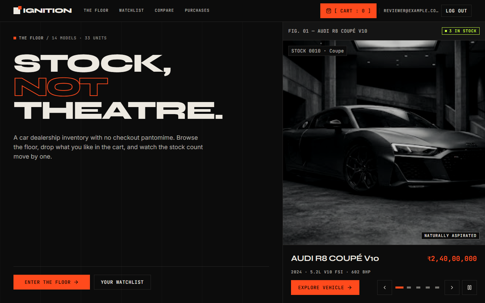
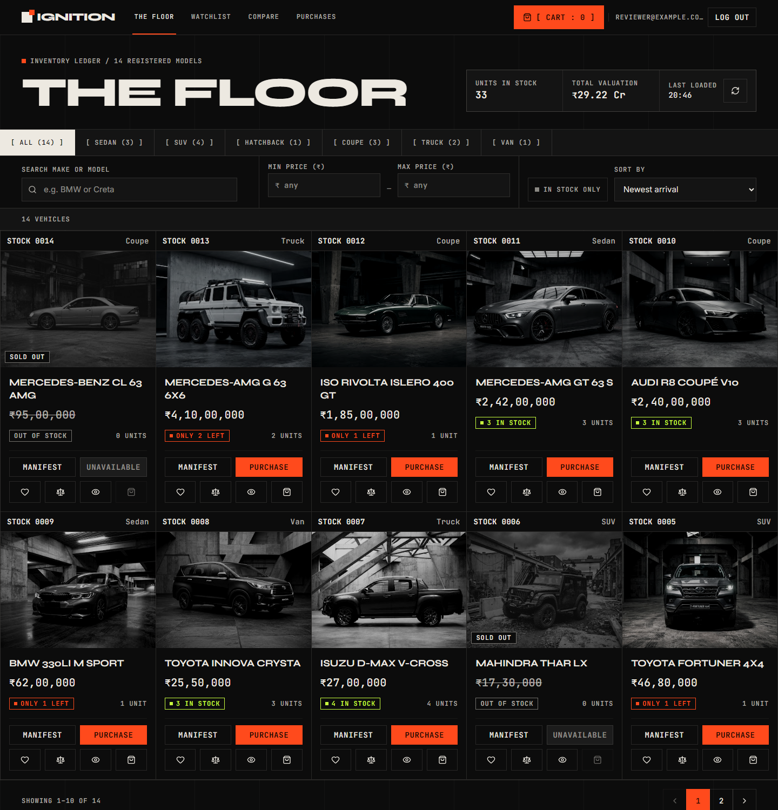
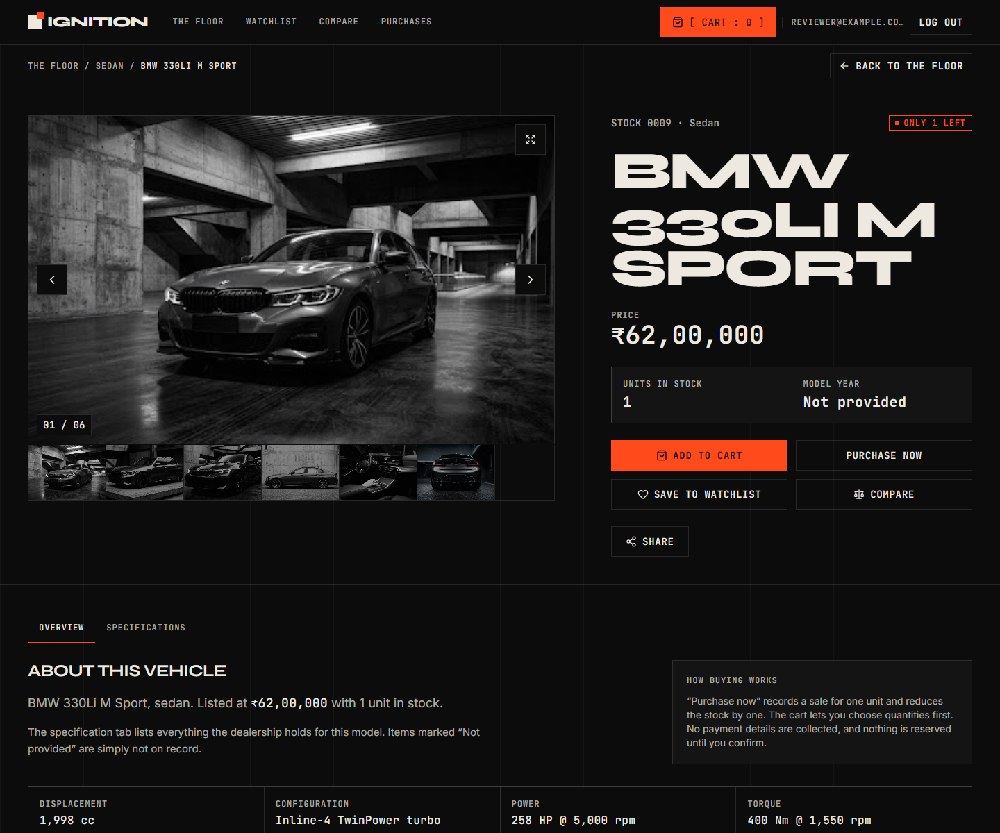
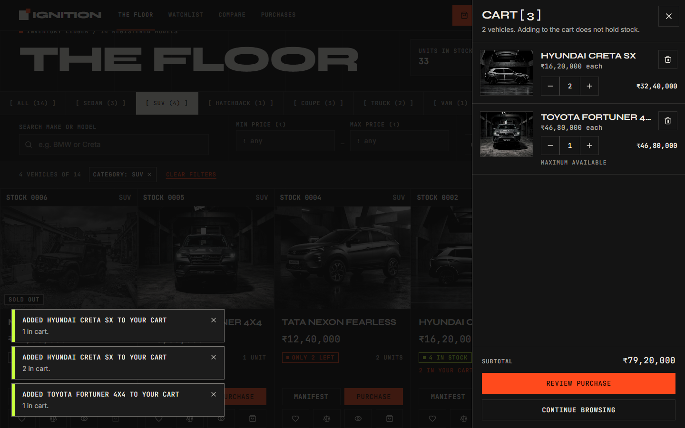
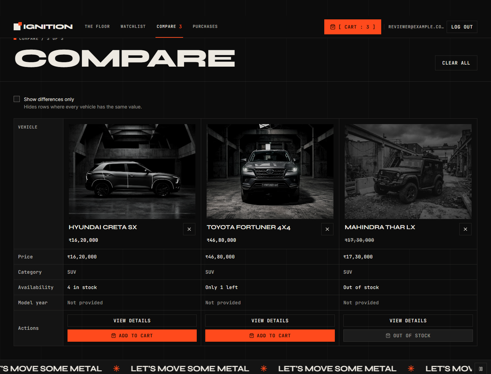
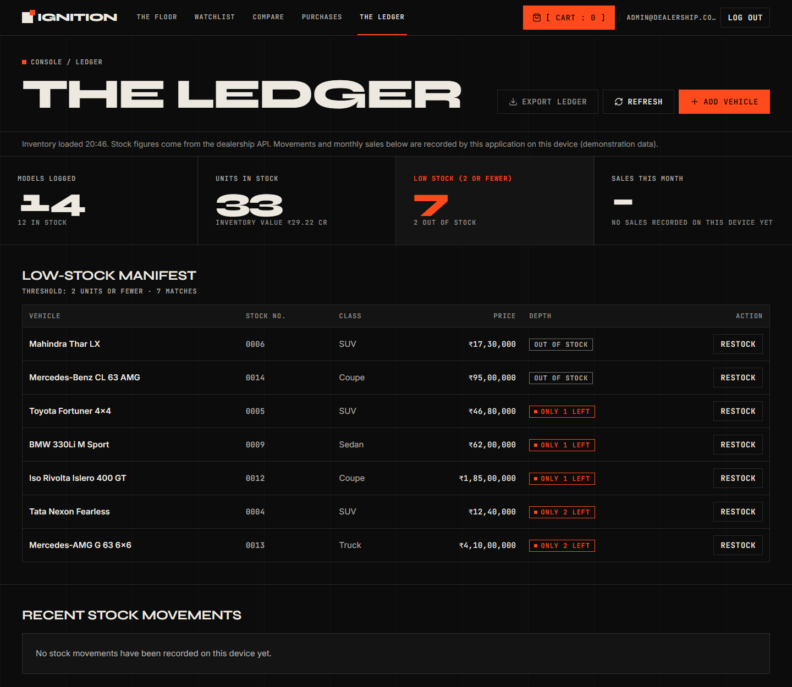
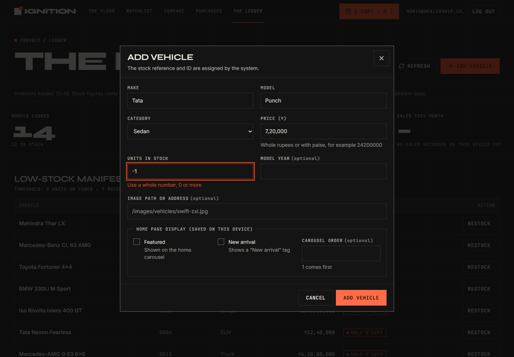
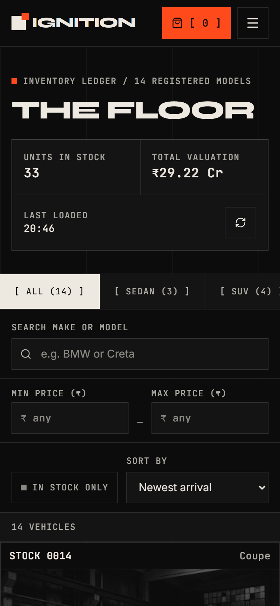
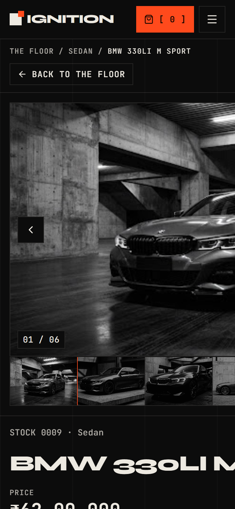

# Car Dealership Inventory System

A full-stack inventory app for a car dealership, built as a TDD kata, with an **IGNITION** frontend (a dark,
square-cornered, typographic design).
Users register and log in, browse and filter the floor, compare vehicles, keep a watchlist, fill a cart and purchase
(stock decreases). Administrators also add, edit, restock, feature and delete vehicles from **The Ledger**.

> **Status:** the API (register, login, vehicles, search, purchase, restock, seed) and the IGNITION frontend are complete and
> tested. See "What is real and what is demo" below.

## Tech stack
| Layer | Tech |
|---|---|
| API | Python 3.12, FastAPI, SQLAlchemy 2, Alembic, Pydantic v2 |
| Auth | JWT (PyJWT, HS256), bcrypt |
| Database | PostgreSQL 16 (via Docker Compose), psycopg 3 |
| Frontend | React 18, TypeScript, Vite, Tailwind CSS, React Router, TanStack Query, React Hook Form + Zod. Fonts: Syne, Inter, JetBrains Mono (bundled) |
| Tests | pytest + pytest-cov (backend), Vitest + Testing Library + MSW (frontend) |

## Documentation
- [ER diagram](docs/ER_DIAGRAM.md) (Chen notation, PostgreSQL DDL)
- [Design review](docs/DESIGN_REVIEW.md) (what was kept, removed and fixed from the AI design export)
- [API contract and permission matrix](docs/API_CONTRACT.md)

## Run locally

### 1. Database
```bash
docker compose up -d db        # PostgreSQL on :5432 with `dealership` and `dealership_test` databases
```
(No Docker? Install PostgreSQL 14+ and create both `dealership` and `dealership_test` databases.)

### 2. Backend
```bash
cd backend
python -m venv .venv && source .venv/bin/activate      # Windows: .venv\\Scripts\\activate
pip install -r requirements-dev.txt
cp .env.example .env                                   # set a real SECRET_KEY
alembic upgrade head                                   # creates the tables
python -m app.scripts.doctor                           # checks tools, .env and both databases
python -m app.scripts.seed                             # creates the admin + sample data (after phase 11)
uvicorn app.main:app --reload                          # http://localhost:8000/docs
```

### 3. Frontend
```bash
cd frontend
cp .env.example .env
npm install
npm run dev                                            # http://localhost:5173
```

### Everything in Docker (optional)
```bash
docker compose up --build        # PostgreSQL, API :8000, UI :3000
```

Open the app and sign in, or register. The home page is public; the floor and everything that shows prices and
stock needs an account, because the API requires a login for vehicle data.

### Seeded admin (for reviewers)
| Email | Password |
|---|---|
| `admin@dealership.com` | `Admin@12345` |

(Configurable via `ADMIN_EMAIL` / `ADMIN_PASSWORD` in `backend/.env`.)

## Tests
```bash
cd backend  && pytest          # needs `docker compose up -d db`; prints coverage, writes backend/reports/test-report.html
cd frontend && npm test
```
**Test report:** _paste the final pytest + coverage summary here._

## The IGNITION frontend
| Screen | What it does |
|---|---|
| **Home** (public) | Split hero, featured-vehicle carousel (previous/next, indicators, pause), a native scroll strip, live inventory figures, recently viewed |
| **The Floor** | Square-cell inventory grid: search, category tabs, min/max price, in-stock toggle, removable filter chips, sort (newest arrival, price, name, stock), pagination. All of it lives in the URL, so Back, refresh and shared links restore it |
| **Vehicle manifest** | Photo gallery with fullscreen viewer, specifications ("Not provided" where unknown), add to cart, purchase now, watchlist, compare, share link. Administrators also see the stock movements |
| **Cart** | Slide-over drawer and a full page. Quantities limited to stock, exact totals, Undo on removal, confirmation, honest partial-failure reporting |
| **Watchlist, Compare, Purchases** | Saved vehicles with Undo, side-by-side comparison of up to three (differences only), purchase history with price snapshots |
| **The Ledger** (admin) | Key figures, low-stock manifest, add / edit / restock / feature / delete with validation and an unsaved-changes guard, stock movements, a real CSV export |

### What is real and what is demo
- **Real, from the API:** accounts and sign in, every vehicle and its stock and price, purchases (the stock really drops, 409 when there is not enough), restocks, edits and deletes. The frontend never replaces these with mock data.
- **Demo, saved in this browser only** (clearly labelled in the app): the cart, watchlist, comparison list, recently viewed, purchase history, the stock-movement log, monthly sales, and the administrator's home-page choices (featured, new arrival, carousel order). They are not shared between devices or people, and are not secure storage.
- **Not provided by the API, so shown as "Not provided":** VIN, most specifications and extra photographs. Specifications and gallery photos exist only for the models whose figures came with the design.
- **Money** is carried as integer paise in the browser, shown with Indian digit grouping (₹2,42,00,000). Prices are stored as 64-bit integers in the database, so crore-level prices fit.

## Screenshots
Taken from the real app against a freshly seeded database.

| Home | The Floor |
|---|---|
|  |  |

| Vehicle manifest | Cart drawer |
|---|---|
|  |  |



| The Ledger | Add vehicle, with validation |
|---|---|
|  |  |

| Sign in | Phone: floor | Phone: vehicle |
|---|---|---|
|  |  |  |

## My AI Usage
**Tools used:**
- **Claude on the web:** early planning, the stack and database design, the setup guides and the first handoff (`files(1).zip`) that I continued from.
- **Claude Code (VS Code extension):** nearly all the code in this repository: the test-first backend, the Docker setup, the IGNITION frontend and the DVM-CAR data import. Commits made with it carry a `Co-Authored-By: Claude` line.
- **Google Stitch:** generated the IGNITION design and the vehicle photos I supplied as a design export.

**How I used them:**
- I gave Claude Code the handoff and let it work phase by phase. The backend (FastAPI, PostgreSQL) was written strictly test-first: a failing test, then the code, then a commit. There are 147 backend tests.
- Claude built the React frontend from my design export and wired it to the real API. Where the API has no feature (cart, watchlist, compare, purchase history), it kept them in the browser and marked them as demo.
- I asked for the status reports, the "is the database connected" check and the run instructions, and I told it when to push. It never pushed on its own.
- I supplied the DVM-CAR dataset and asked for it to be merged into the project. Claude chose 60 models, converted the prices, copied only those photos and added the credit.

**Reflection:**
- What went well: test-first caught real bugs early, such as an out-of-stock race in purchases and prices that overflowed a 32-bit column. Checking the finished screens in a real browser found layout bugs the unit tests could not see.
- What I had to correct or decide:
  - The first push was rejected after I rewrote the GitHub history, so the commits had to be rebased onto it.
  - I removed an unrequested redesign Claude had left in my working copy, and later asked for the new one properly.
  - I removed a stray contributor from the history. GitHub's sidebar still showed the name for a while afterwards.
  - Claude once wrote a wrong commit message, then flagged and fixed it.
  - Importing the new data exposed a bug: the Floor silently stopped at 50 vehicles, because the frontend never asked the API for more than its first page. Claude fixed it with a test first.
- Limits to know about: the AI wrote most of the code, so I treated each result as something to check, not trust; the tests, CI and the browser checks are how I did that. The dataset photos are small, and the DVM-CAR stock numbers are generated.

Raw chat logs are in [`PROMPTS.md`](PROMPTS.md).

## Project structure
```
backend/   app/{api,services,repositories,models,schemas,core,db,scripts}  alembic/  tests/{unit,integration}
frontend/  src/{api,components,pages,hooks,context,data,lib,types,test}   (data/ holds the demo layer)
docs/      ER_DIAGRAM.md  API_CONTRACT.md  DESIGN_REVIEW.md
```

## Credits
- Vehicle photographs and the IGNITION visual design: generated with Google Stitch (AI) and supplied as a design export. They are small (about 500 px wide), so large views are soft, and five were cropped to remove screenshot borders and a competing brand sign that were baked into the pictures. Unused: one Islero photo (different paint colour from the one used) and the supplied wordmark PNG.
- Fonts: Syne, Inter and JetBrains Mono (SIL Open Font License) via `@fontsource`. Icons: `lucide-react`.
- Extra inventory: 60 of the 74 seeded vehicles come from **DVM-CAR** (licence CC BY-NC 4.0, so non-commercial use only): Jingming Huang, Bowei Chen, Lan Luo, Shigang Yue and Iadh Ounis (2022), "DVM-CAR: A large-scale automotive dataset for visual marketing research and applications", IEEE International Conference on Big Data, pp. 4130-4137. Names, years and photographs are from the dataset. The prices are its historical UK prices in pounds, converted at a fixed 105 rupees per pound and rounded to the nearest 1,000 rupees. The categories were chosen by hand and the stock numbers are generated (the dataset has neither). The 300 px photos are small, so they look soft when enlarged. Rebuild with `python -I backend/tools/build_dvm_catalogue.py <path to the DVM-CAR folder>`; the dataset itself is not in this repository.
