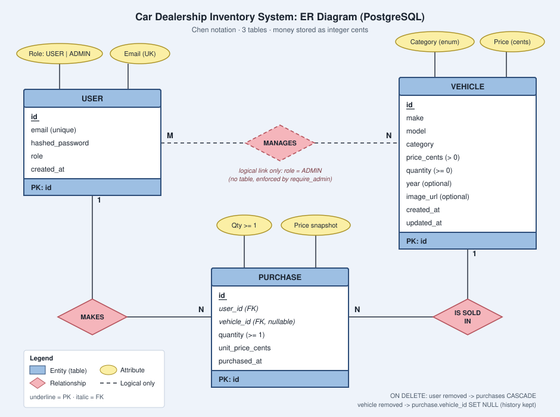
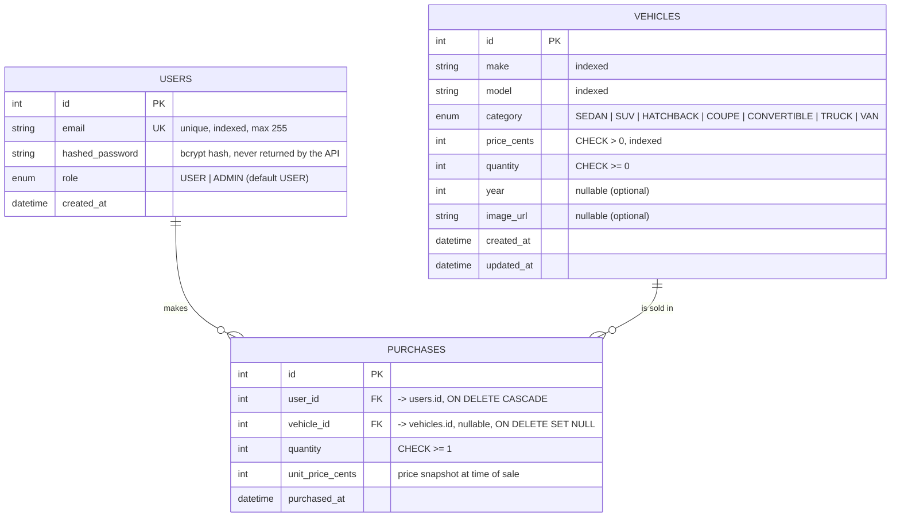

# Entity-Relationship Diagram

Chen notation (entities, relationship diamonds, attribute ovals). Source: `ER_DIAGRAM.svg` (PNG copy: `ER_DIAGRAM.png`).



How to read it
- **MAKES**: one USER makes many PURCHASES (1 : N).
- **IS SOLD IN**: one VEHICLE appears in many PURCHASES (1 : N). `purchases.vehicle_id` is nullable so history survives a vehicle delete.
- **MANAGES** (dashed): a logical link only. Users with `role = ADMIN` manage vehicles (create, update, delete, restock). There is no table for it; it is enforced by the `require_admin` dependency.

## Crow's-foot version (renders on GitHub)



## Notes

| Topic | Decision |
|---|---|
| Required by the kata | `USERS` and `VEHICLES`. `PURCHASES` is an extra audit trail (small, but shows good design). |
| Database | **PostgreSQL 16**; tests use a separate `dealership_test` database. |
| Money | Stored as **integer cents** (`price_cents`) to avoid float errors. The API exposes a decimal `price`. |
| Stock safety | `CHECK (quantity >= 0)` is the last line of defence; the purchase is a single conditional `UPDATE ... WHERE quantity >= :qty`. |
| Deleting a vehicle | Hard delete. Purchase history is kept; `vehicle_id` becomes `NULL`, and `unit_price_cents` still records what was paid. |
| Roles | Only `USER` or `ADMIN`. Registration always creates `USER`; the admin is created by `python -m app.scripts.seed`. |
| Search indexes | `make`, `model`, `category`, `price_cents` are indexed because `/api/vehicles/search` filters on them. |

## Reference DDL (PostgreSQL)

Alembic generates this from the models (`backend/alembic/versions/0001_initial_schema.py`); shown here for reading.

```sql
CREATE TYPE role            AS ENUM ('USER', 'ADMIN');
CREATE TYPE vehiclecategory AS ENUM ('SEDAN','SUV','HATCHBACK','COUPE','CONVERTIBLE','TRUCK','VAN');

CREATE TABLE users (
  id              SERIAL PRIMARY KEY,
  email           VARCHAR(255) NOT NULL,
  hashed_password VARCHAR(255) NOT NULL,
  role            role         NOT NULL,            -- default USER is applied by the app
  created_at      TIMESTAMPTZ  NOT NULL
);
CREATE UNIQUE INDEX ix_users_email ON users(email);

CREATE TABLE vehicles (
  id          SERIAL PRIMARY KEY,
  make        VARCHAR(80)     NOT NULL,
  model       VARCHAR(80)     NOT NULL,
  category    vehiclecategory NOT NULL,
  price_cents INTEGER         NOT NULL CONSTRAINT ck_vehicle_price_positive CHECK (price_cents > 0),
  quantity    INTEGER         NOT NULL CONSTRAINT ck_vehicle_quantity_non_negative CHECK (quantity >= 0),
  year        INTEGER,
  image_url   VARCHAR(500),
  created_at  TIMESTAMPTZ     NOT NULL,
  updated_at  TIMESTAMPTZ     NOT NULL
);
CREATE INDEX ix_vehicles_make        ON vehicles(make);
CREATE INDEX ix_vehicles_model       ON vehicles(model);
CREATE INDEX ix_vehicles_category    ON vehicles(category);
CREATE INDEX ix_vehicles_price_cents ON vehicles(price_cents);

CREATE TABLE purchases (
  id               SERIAL PRIMARY KEY,
  user_id          INTEGER     NOT NULL REFERENCES users(id)    ON DELETE CASCADE,
  vehicle_id       INTEGER              REFERENCES vehicles(id) ON DELETE SET NULL,
  quantity         INTEGER     NOT NULL CONSTRAINT ck_purchase_quantity_positive CHECK (quantity >= 1),
  unit_price_cents INTEGER     NOT NULL,
  purchased_at     TIMESTAMPTZ NOT NULL
);
CREATE INDEX ix_purchases_user_id    ON purchases(user_id);
CREATE INDEX ix_purchases_vehicle_id ON purchases(vehicle_id);
```

PostgreSQL notes
- `role` and `category` are native ENUM types, so the database itself rejects invalid values. Adding a category later needs a migration (`ALTER TYPE ... ADD VALUE`).
- PostgreSQL does not index foreign keys automatically, so the two FK indexes on `purchases` are explicit.
- The atomic purchase `UPDATE vehicles SET quantity = quantity - :q WHERE id = :id AND quantity >= :q` takes a row lock, so two concurrent buyers can never push stock below zero.
